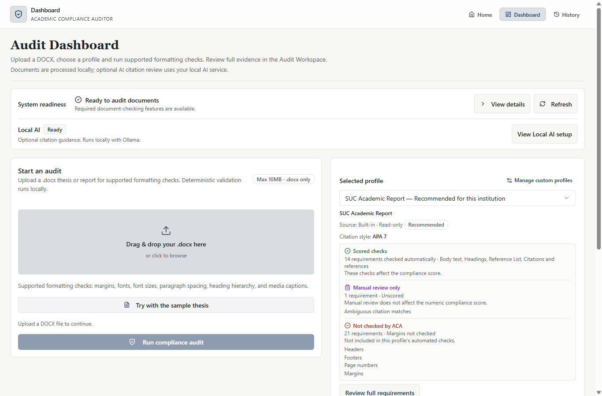
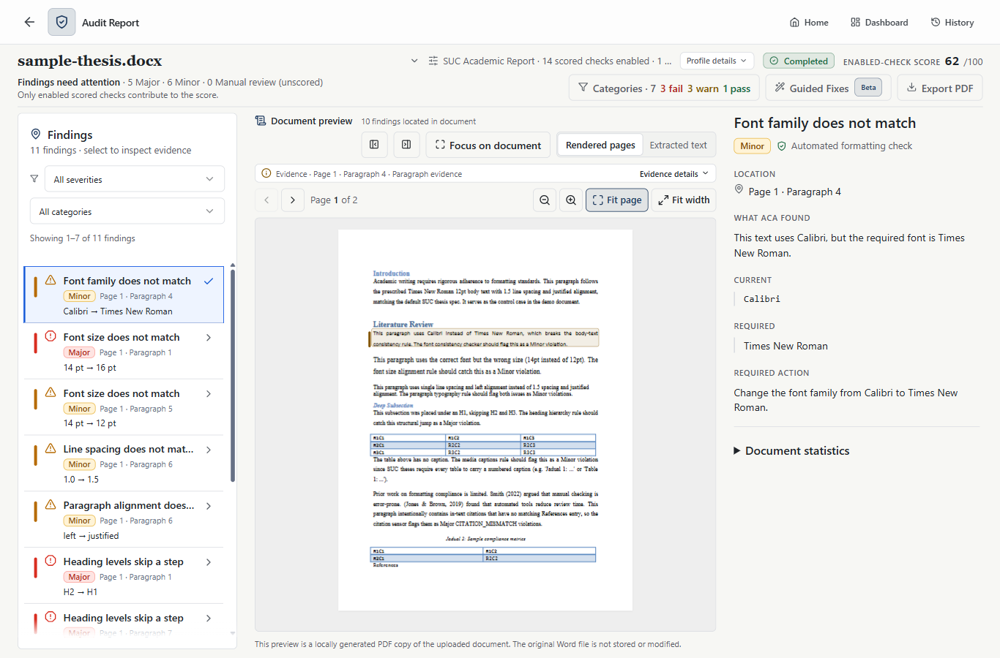
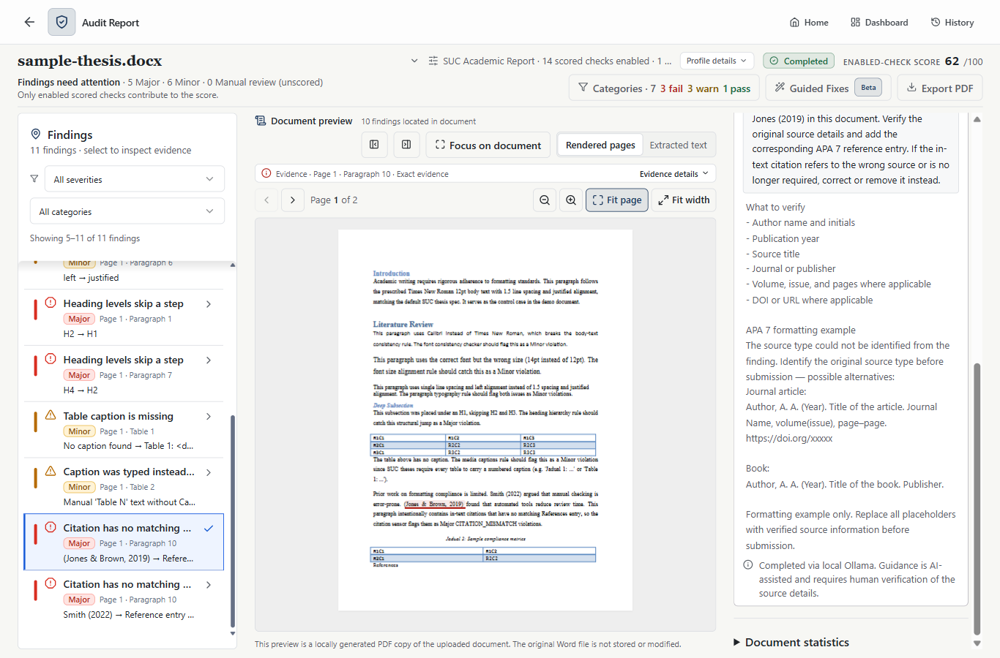

# Academic Compliance Auditor

Academic Compliance Auditor (ACA) is a local Windows application for auditing academic DOCX documents against a selected profile. Deterministic rules produce findings and a compliance score. The app shows evidence in a document preview, with rendered pages when LibreOffice is available. Bounded Guided Fixes can produce a separate corrected copy, and optional local Ollama guidance can explain eligible citation findings. Neither changes the original document.

## Academic Project

- **Project title:** A Hybrid Architecture for Automated Academic Compliance Auditing
- **Version:** 1.0.0
- **Purpose:** Non-commercial final-year project for academic demonstration and evaluation by supervisors, examiners and invited evaluators.

The project separates repeatable document checks from optional model-generated explanations. To see the workflow before using your own document, open the Audit Dashboard, select **Try with the sample thesis**, and run the audit. Open a finding to compare the detected and required values and see the evidence ACA could locate. The score represents the selected profile's enabled scored checks; it is not a grade or an assurance of institutional acceptance.

## Key Features

- Audit DOCX formatting and supported APA 7 citation checks with deterministic rules.
- Review a compliance score and categorised findings.
- Compare detected **Current** values with **Required** values where available.
- Inspect rendered page evidence through local LibreOffice.
- Reopen audits from History and export a PDF report.
- Review and confirm eligible Guided Fixes to produce a separate corrected DOCX.
- Preserve the original DOCX throughout the audit and correction workflows.
- Request optional Local AI citation guidance through Ollama.

## Download Academic Evaluation Build

The academic-evaluation installer will be available from the repository’s Releases page after publication.

**Installer:** `ACA-FYP-UX-Updated-Private-Evaluation-Setup.exe`

**SHA-256:** `59e71fd7b21a850c2a33b4e4c0fdb02ca4f37eccbdb205054cddaee949d6f101`

> **Unsigned academic evaluation build.** Windows may display an **Unknown Publisher** or **Microsoft Defender SmartScreen** warning. This build is for **non-commercial academic evaluation only**. It is not a production or commercial release.

Before running the installer, compare its SHA-256 with the value above. Do not run a file whose checksum you cannot verify. The Windows installer does not require a separate Python or Node.js installation. Obtain LibreOffice and Ollama separately if you want to try those optional features; the installer does not contain either application or the Ollama model.

## Quick Start from Source

Use **Python 3.12**, Node.js **22.13+ in the 22.x line or 24.x**, and **npm 10+**. From the repository root, open a Windows PowerShell terminal for the backend:

```powershell
cd backend
python -m venv .venv
.venv\Scripts\Activate.ps1
pip install -r requirements.txt
Copy-Item .env.example .env
python -m alembic upgrade head
python -m uvicorn app.main:app --host 127.0.0.1 --port 8000
```

Copy `.env.example` only on initial setup; keep an existing `.env`. The development defaults use a local SQLite database and a loopback Ollama address. Do not point development migrations at a database used by the packaged application.

From the repository root in a **second** PowerShell terminal:

```powershell
cd frontend
npm install
npm run dev
```

Keep both terminals open and browse to `http://localhost:5173`. The Dashboard should be ready to audit even if optional components are absent. Use the synthetic sample to check the source setup without supplying a personal document.

### Architecture

The React frontend uses Vite in development and calls a local FastAPI backend. The backend applies deterministic rules to the DOCX and stores completed audit results in SQLite so History can reopen them. If available, LibreOffice renders pages locally; the app can still show extracted text if rendering is unavailable. The separate Local AI action uses loopback Ollama to explain supported findings after approval, without taking part in the rules or scoring.

## Optional Local AI

The deterministic audit, score and findings work without Local AI. To try guidance, run Ollama locally with the verified `qwen3.5:4b` model. ACA asks for explicit consent before requesting guidance for an eligible finding or starting an optional in-app model download. You can decline and keep using the audit results.

Local AI provides explanatory guidance only. It does not detect, add or remove findings, determine scores, or edit the DOCX. It cannot verify that a source exists, that a bibliography entry is correct, or that a DOI is accurate. Check the original sources before acting on suggestions.

## Guided Fix Safety

Guided Fixes are optional and limited to changes ACA can verify. Open the corrected file in your authoring application and inspect it before using it for submission.

- Only eligible findings can enter the Guided Fix workflow.
- Review the proposed changes and explicitly confirm before applying them.
- Download a separate corrected DOCX.
- The original DOCX is preserved.
- ACA reopens and verifies the output before offering the download.
- Correct unsupported findings manually.

## Screenshots

### Audit Dashboard



### Rendered Page Preview



### Local Ollama Guidance



## Documentation

- [Installation](docs/INSTALLATION.md)
- [User Guide](docs/USER_GUIDE.md)
- [Architecture](#architecture)
- [Privacy and Security](docs/PRIVACY.md)
- [Testing](docs/developer/DEVELOPER_SETUP.md#tests-and-checks)
- [Developer Documentation](docs/developer/DEVELOPER_SETUP.md)
- [Guided Fix Reference](docs/GUIDED_FIX_REFERENCE.md)
- [THIRD_PARTY_NOTICES](THIRD_PARTY_NOTICES.md)

## Verified Evaluation

- The representative synthetic sample scored **62/100** with **11 findings: five major and six minor**.
- Finding detail, rendered preview, History reopen and PDF export passed in the installed evaluation. Local Ollama guidance with `qwen3.5:4b` passed after explicit consent.
- Recorded source checks: **1,109 frontend tests passed**. Earlier backend validation recorded **4,380 passed**, **two baseline-existing packaging-test failures**, and **four skipped**.

## Limitations

- DOCX input only. The automated checks do not cover every institutional requirement.
- Rendered page preview requires LibreOffice; optional Local AI requires Ollama and `qwen3.5:4b`.
- The installer is unsigned. Validation covered an **existing-install update only**; complete clean-machine 24-scenario acceptance was not completed.
- Graceful in-application shutdown was not independently verified.
- ACA does not provide complete bibliographic or DOI verification.

## Licence and Distribution

ACA is published as a non-commercial academic final-year project. The evaluation installer is provided for educational demonstration and evaluation. Third-party components remain subject to their respective licences. See [THIRD_PARTY_NOTICES](THIRD_PARTY_NOTICES.md).

ACA remains proprietary, with all rights reserved. The operative distribution terms are in [LICENSE](LICENSE).
