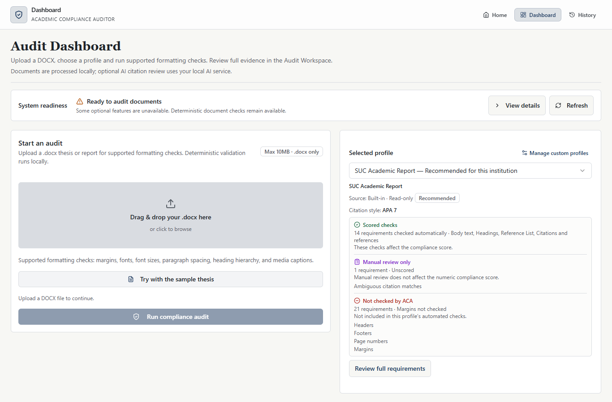
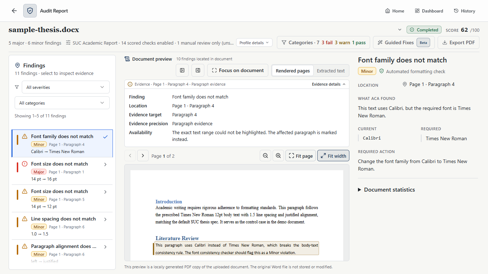

# Academic Compliance Auditor

Academic Compliance Auditor (ACA) is a Windows application that reviews academic DOCX documents for formatting and APA 7 citation issues. All checks run locally on your machine. Findings are guidance for your own review — ACA does not guarantee institutional acceptance or complete academic compliance.

## Download

Academic Compliance Auditor is currently distributed privately for evaluation.

Installer: `AcademicComplianceAuditor-Setup-1.0.0.exe`

Obtain it from:

- the project owner, or
- the approved university submission or evaluation channel

Please note:

- A public download page is not currently available.
- The installer is unsigned, so Windows may display an *Unknown publisher* or SmartScreen warning. See [Troubleshooting](docs/TROUBLESHOOTING.md).

## Quick Start

1. Obtain the Windows installer from the project owner or your approved evaluation channel.
2. Double-click the Setup EXE.
3. Complete the installation — per-user, no administrator rights needed.
4. Open ACA from the Windows Start Menu.
5. Upload a DOCX document or use the sample document.
   Encrypted or password-protected documents cannot be audited; remove password
   protection in Word and try again.
   Invalid or damaged DOCX files are rejected without creating an Audit or History
   entry. Open the file in Word, save it again as a `.docx` file, and try again.
6. Review findings and export the PDF report.

Python and Node.js are not required.

## Review Findings with Page Evidence

After an audit, ACA shows what it found and why:

- Identifies supported formatting and citation issues, grouped by severity.
- Shows the value found in your document and the required value (Current and Required).
- Links supported body findings to a rendered page preview when the optional LibreOffice integration is available, or to extracted text otherwise. Structural reviews identify stored section/story definitions without a visual region.
- Produces a PDF report you can save or share.

### Guided Fix downloads

Closing Guided Fixes or switching audits discards any late download response;
it cannot save a corrected copy or update the current workflow. Download links
remain one-use: if the server already consumed a discarded request, repeat
Review and Apply from the unchanged original document to obtain a new link.
Download progress is announced only while the current request is pending.
Closing or restarting Guided Fixes clears obsolete notices; reopening does not
replay a previous Download or availability announcement.

### Guided Fix quantities and locations

Selection, Review and verified results distinguish findings from affected
locations. One grouped finding can affect several text locations within the
same paragraph. Selection totals count shared paragraph/run targets once;
the 20-finding limit and all safety checks remain unchanged. Incomplete location
metadata is shown as **Location count unavailable**, not a guessed quantity.
Before/after re-audit rows identify one finding and label its occurrence count;
repeated paragraph labels are displayed once without changing that count.

### Font Guided Fix safety

Existing `FONT_CONSISTENCY` and `FONT_SIZE` corrections now require supported
plain-ASCII text, explicit agreeing direct font-family slots, and an unambiguous
used character/paragraph-style and document-default chain. Inherited font
declarations, themes, alternate-slot conflicts, script/bidi controls, unsupported
structures and malformed evidence remain manual—even when direct formatting
might override them. Ordinary Word templates may therefore offer fewer automatic
corrections. ACA never removes inherited formatting to make an uploaded file
eligible.

Both operations independently use the audit's immutable saved Profile Snapshot,
not the current Profile editor. Size requirements and Current evidence must be
exact integer half-points: 12pt and 12.5pt are representable; 12.005pt and 12.25pt
remain manual before Apply is offered. Family corrections change only the three
authorized direct family slots; size corrections change only the direct size.
Every selected run's raw saved output is checked exactly after reopening, before
package preservation, corrected-file re-audit and the separate one-use Download.
A mixed safe/unsafe selection is refused as a whole.

The original DOCX, saved Audit, Snapshot, History, PDF, scoring and categories
remain unchanged. This certifies eligible OOXML settings, not installed-font
availability, font substitution, arbitrary-script rendering or Word pagination.
No candidate was added; these font checks do not certify the whole Guided Fix set.

In Review, Tab can focus the details area, marked by an inset focus ring.
When its content overflows, use the arrow keys, Page Up/Page Down or Home/End
to scroll it; Tab continues to the existing review actions.

### Line-spacing Guided Fix safety

Existing `LINE_SPACING` corrections require a nonempty plain main-story body
paragraph, qualifying Appendix prose, or an individually addressed Reference
entry with an enabled saved requirement. Only explicit canonical positive
`w:line` integers with `w:lineRule="auto"` qualify. The used paragraph-style and
document-default graph must be unambiguous and contain no inherited line
declarations or linked styles. Numbering, wrappers, section boundaries,
competing spacing controls, snap-to-grid settings and any main-document grid
remain manual. Ordinary Word templates may therefore lose automatic
availability; ACA never clears those settings to make an upload eligible.

The audit's immutable saved Profile Snapshot independently supplies the
requirement, not the current Profile editor or a hardcoded heading default.
Saved decimal multipliers must be exactly representable in integer 240ths of a
line: 1.5, 1.15 and 1.0125 qualify; 1.501 and 1.333 do not. Legacy v1/v2
Reference requirements remain manual because their saved payload has no resolved
enforcement toggle. Loadable legacy body requirements use the same safety gates.

Confirmed Review preserves the detector's literal Current/Required strings only
after proving multiplier units and source identity. Exact, atLeast, absolute,
inherited, missing and malformed evidence cannot reach a successful Review.
Unsupported absolute findings may still show a provisional numeric Current
before upload; refusal does not change their client-side candidate classification.

Only the selected `line`/`lineRule` attributes change. Every selected paragraph
is independently reopened and checked for the exact required raw integer and
literal `auto`, with paragraph text, physical run boundaries and fresh role
matched against pristine original bytes. No getter tolerance, rounding, implicit
rule or detector silence certifies the output. Mixed safe/unsafe selections are
refused atomically. Unchanged package preservation and deterministic re-audit
must pass before storage and the separate one-use Download; missing required
rendered-page evidence remains a refusal.

The original DOCX, Audit, Snapshot, History, PDF, scoring and categories remain
unchanged. This certifies eligible encoded settings, not Word rendering or
physical pagination. It is not a complete Guided Fix freeze or release approval.

### Before/after paragraph spacing Guided Fix safety

Existing `SPACE_BEFORE` and `SPACE_AFTER` corrections require an explicit,
readable direct point setting and an unambiguous used paragraph-style and
document-default chain. Review and Apply reject selected-side line-unit
controls, active automatic spacing, active contextual spacing, numbering-owned
paragraphs and malformed or otherwise unprovable evidence. Valid explicit false
flags may override valid inherited true flags; malformed inherited controls
remain manual even when shadowed. Unrelated opposite-side controls are preserved.

Requirements come from the saved Snapshot and must be exactly representable in
twentieths of a point (twips) within 0–240 pt. For example, 6.05pt is eligible
but 6.00000000001pt and 6.01pt stay manual rather than being rounded. The
persisted Current value must exactly match the direct source attribute; a
source-to-requirement difference of 20 twips or less stays manual even if the
float-based detector reported a finding. Explicit zero is valid and is written
as `"0"`.

The reopened copy is checked against the original source, saved requirement,
reviewed targets and raw selected attributes. Separately selected properties
are independently verified; other spacing attributes and controls are
preserved. Simple fields, paragraph-level section properties and ambiguous
bookmarks remain manual. A mixed safe/unsafe selection is rejected as a whole.
These checks certify the point **setting**, not an exact rendered gap; document
grids and snap-to-grid are preserved. The original DOCX, saved audit, Snapshot,
History and PDF remain unchanged.

The before/after-spacing hardening alone does not establish complete Guided Fix
release closure. Malformed DOCX issues remain independent.

### Ambient aggregate re-audit hardening

Unselected ambient Reference and citation aggregate findings can accompany
unrelated, eligible Guided Fixes even when their stored paragraph indexes are
capped at 10. Re-audit compares the available locations and total occurrence
counts, and still rejects new or worsened findings. Selected findings must have
complete target locations; Reference-specific entry aggregate rules remain
manual-only. No Guided Fix candidate rules were added.

### Guided Fix package safety

Review refuses corrections for digitally signed, protected or write-protected,
and macro-bearing packages, including macro-bearing files renamed `.docx`.
Correct the selected findings manually in Word; the original remains unchanged.
Unsigned, unprotected, macro-free DOCX files remain subject to the existing
rule-specific Review, preservation and re-audit checks. Guided Fix does not execute
macros or claim to preserve signatures or macro parts in corrected copies.
Audit-only availability does not certify macro trust or safety. Native `.docm`
uploads remain unsupported; encrypted-upload handling is separate work.

### Reference List heading bold Guided Fix

Guided Fixes can make a verified Reference List heading **Bold** or **Not bold**
according to the audit's saved Profile Snapshot. Review identifies one affected
heading paragraph and confirms every nonempty direct text segment, including
whitespace-only segments. Only its direct bold values change; wording,
alignment, Reference entries, shared styles and empty runs remain unchanged.

This correction is unavailable when the heading is ambiguous, its direct bold
evidence is inherited, mixed or unresolved, or its structure is unsupported.
Signed, protected and macro-enabled packages are also unavailable for this
correction. Follow the manual guidance instead; ACA does not guess or partially
correct the heading.

Apply verifies every target segment, package preservation and a corrected-file
re-audit before offering the separate, one-use Download. The original DOCX,
saved Audit, Snapshot, History and PDF remain unchanged. Inspect the corrected
copy in your authoring application before submission; auditing it again requires
an explicit upload.

### Optional Header, Footer and Page Number reviews

Custom Profiles can independently enable **Check Header requirements**,
**Check Footer requirements**, and **Check Page Number requirements**. All
three default to Off (**Not checked**); Built-in Profiles remain unchanged.
Page Number placement can be Header, Footer or Either without enabling a
Header or Footer content requirement.

These checks inspect each section's stored **Normal-pages** definition,
including effective inherited definitions. They do not inspect first-page
or even-page definitions or verify rendered visibility, numbering or sequence.
A resolved PAGE field satisfies the Page Number requirement; typed digits
and total-page fields do not. Missing/empty definitions and insufficient
supported evidence produce **Manual review** findings with no score deduction.
When the section's first rendered page can be proven, selecting a review
opens that page with **Page-level structural evidence**, but no exact
Header/Footer highlight or rectangle. Otherwise, **Structural evidence only**
shows **Rendered page could not be determined** and preserves the current
preview page. Corrections remain manual in Word; Local AI and Guided Fixes
are unavailable for these findings.
History and PDF reports retain the settings and findings saved with the audit.

### Optional Reference DOI presentation check

Custom Profiles can enable **Check Reference DOI format**; it is Off by default
and Built-in Profiles remain unchanged. When enabled, the selected profile requires
the visible format `https://doi.org/<doi>`. ACA reports only definite legacy
presentations such as `doi:` or `http://doi.org/`, once per affected Reference entry.

This offline check uses an ACA-supported conservative lexical subset, not complete
DOI syntax or APA 7 validation. Canonical, absent, ambiguous, unsupported and
multiple-candidate text stays silent; hidden hyperlink targets are ignored.
ACA does not verify DOI registration or resolution, require a DOI, rewrite the
document, or offer an automatic correction. Current values retain source spelling.

## Optional Features

Two optional components extend ACA, but neither is required:

- **LibreOffice** enables rendered-page previews and original-document page locations. Without it, extracted-text evidence remains available.
- **Ollama** enables optional **Local AI Citation Guidance** — suggestions for APA 7 in-text citation formatting only. It is never a full academic review, never rewrites or corrects your DOCX, and every suggestion needs your own review.

Core deterministic audits — document checks, formatting findings, rendered-page previews, Guided Fixes, PDF report export, and Audit History — remain available without either component. When an optional component is missing, setup actions appear in the Dashboard's **System Readiness** card. ACA never installs third-party software; the only download it can start is the optional citation-guidance model, after you explicitly confirm it.

## Documentation

**User documentation**

- [Installation](docs/INSTALLATION.md)
- [User Guide](docs/USER_GUIDE.md)
- [Troubleshooting](docs/TROUBLESHOOTING.md)
- [Privacy](docs/PRIVACY.md)
- [Known Limitations](docs/KNOWN_LIMITATIONS.md)

**Developer documentation**

- [Developer Setup](docs/developer/DEVELOPER_SETUP.md)
- [Build and Release](docs/developer/BUILD_AND_RELEASE.md)
- [Technical Troubleshooting](docs/developer/TECHNICAL_TROUBLESHOOTING.md)

**Evaluation documentation** (for the project owner and evaluators)

- [Release Checklist](docs/evaluation/RELEASE_CHECKLIST.md)
- [End-User Installation Test](docs/evaluation/END_USER_INSTALLATION_TEST.md)

**Other**

- [Third-Party Notices](THIRD_PARTY_NOTICES.md)

## License Status

No project software license has been selected. ACA remains All rights reserved.
